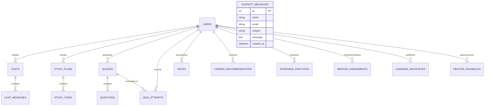

# SkillMate AI - Database Design & Schema Architecture

## 1. Overview
The database for **SkillMate AI** is designed as a normalized, relational system implemented in **MySQL 8.0** using **Sequelize ORM**. It adheres to Third Normal Form (3NF) to eliminate data redundancy while providing referential integrity, indexes for accelerated lookups, and cascade deletion.

- **Database Name:** `skillmate_ai`
- **Dialect:** MySQL (`mysql2` driver)
- **Engine:** InnoDB
- **Charset:** `utf8mb4`
- **Collation:** `utf8mb4_unicode_ci`

---

## 2. Entity Relationship Diagram (ERD)

---

## 3. Relational Table Specifications

### 3.1 `users`
Stores all platform accounts across all roles (STUDENT, MENTOR, ADMIN).
| Column | Type | Constraints | Description |
|---|---|---|---|
| `id` | INT | PK, AUTO_INCREMENT | Unique User Identifier |
| `name` | VARCHAR(100) | NOT NULL | User's full name |
| `email` | VARCHAR(150) | NOT NULL, UNIQUE, INDEX | Login email |
| `password` | VARCHAR(255) | NOT NULL | Bcrypt hashed password (salt 10) |
| `role` | ENUM('STUDENT', 'ADMIN', 'MENTOR') | NOT NULL, DEFAULT 'STUDENT', INDEX | Authorized role |
| `education` | VARCHAR(100) | NULL | Degree or qualification |
| `college` | VARCHAR(150) | NULL | University / Institution |
| `interests` | VARCHAR(255) | NULL | Subject / Career areas |
| `profile_image` | VARCHAR(255) | NULL | Avatar URL or file path |
| `is_active` | BOOLEAN | DEFAULT TRUE, INDEX | Account active flag |
| `created_at` | DATETIME | DEFAULT NOW() | Timestamp |
| `updated_at` | DATETIME | DEFAULT NOW() | Timestamp |

### 3.2 `chats`
Represents AI tutoring chat threads initiated by students.
| Column | Type | Constraints | Description |
|---|---|---|---|
| `id` | INT | PK, AUTO_INCREMENT | Chat ID |
| `user_id` | INT | FK -> users.id (CASCADE), INDEX | Student owner |
| `title` | VARCHAR(255) | DEFAULT 'New Learning Session' | Chat topic title |
| `created_at` | DATETIME | DEFAULT NOW() | Timestamp |
| `updated_at` | DATETIME | DEFAULT NOW() | Timestamp |

### 3.3 `chat_messages`
Stores individual conversation turns between students and the AI assistant.
| Column | Type | Constraints | Description |
|---|---|---|---|
| `id` | INT | PK, AUTO_INCREMENT | Message ID |
| `chat_id` | INT | FK -> chats.id (CASCADE), INDEX | Chat session reference |
| `sender` | ENUM('user', 'assistant') | NOT NULL | Speaker origin |
| `message` | LONGTEXT | NOT NULL | Markdown content |
| `created_at` | DATETIME | DEFAULT NOW() | Timestamp |

### 3.4 `study_plans`
Stores personalized exam preparation plans.
| Column | Type | Constraints | Description |
|---|---|---|---|
| `id` | INT | PK, AUTO_INCREMENT | Plan ID |
| `user_id` | INT | FK -> users.id (CASCADE), INDEX | Student creator |
| `title` | VARCHAR(255) | NOT NULL | Plan title |
| `subject` | VARCHAR(150) | NOT NULL | Academic subject |
| `target_date` | DATEONLY | NOT NULL | Completion deadline |
| `daily_hours` | FLOAT | DEFAULT 2.0 | Study hours allocation |
| `difficulty` | ENUM('Beginner', 'Intermediate', 'Advanced') | DEFAULT 'Beginner' | Difficulty tier |
| `status` | ENUM('in_progress', 'completed', 'paused') | DEFAULT 'in_progress', INDEX | Execution status |
| `created_at` | DATETIME | DEFAULT NOW() | Timestamp |
| `updated_at` | DATETIME | DEFAULT NOW() | Timestamp |

### 3.5 `study_tasks`
Day-wise actionable milestones within each study plan.
| Column | Type | Constraints | Description |
|---|---|---|---|
| `id` | INT | PK, AUTO_INCREMENT | Task ID |
| `study_plan_id` | INT | FK -> study_plans.id (CASCADE), INDEX | Parent study plan |
| `task_title` | VARCHAR(255) | NOT NULL | Milestone title |
| `task_description` | TEXT | NULL | Concepts to review |
| `task_date` | DATEONLY | NULL | Scheduled target date |
| `is_completed` | BOOLEAN | DEFAULT FALSE, INDEX | Task completion status |
| `created_at` | DATETIME | DEFAULT NOW() | Timestamp |

### 3.6 `quizzes`
Generated multiple-choice quizzes.
| Column | Type | Constraints | Description |
|---|---|---|---|
| `id` | INT | PK, AUTO_INCREMENT | Quiz ID |
| `user_id` | INT | FK -> users.id (CASCADE), INDEX | Student taker |
| `subject` | VARCHAR(150) | NOT NULL, INDEX | Subject name |
| `topic` | VARCHAR(200) | NOT NULL | Concept / unit |
| `difficulty` | ENUM('Easy', 'Medium', 'Hard') | DEFAULT 'Medium' | Assessment difficulty |
| `total_questions` | INT | DEFAULT 5 | Number of MCQs |
| `score` | INT | DEFAULT 0 | Last scored percentage |
| `created_at` | DATETIME | DEFAULT NOW() | Timestamp |

### 3.7 `questions`
Individual four-option questions belonging to a quiz.
| Column | Type | Constraints | Description |
|---|---|---|---|
| `id` | INT | PK, AUTO_INCREMENT | Question ID |
| `quiz_id` | INT | FK -> quizzes.id (CASCADE), INDEX | Parent quiz |
| `question_text` | TEXT | NOT NULL | Question wording |
| `option_a` | VARCHAR(255) | NOT NULL | Option A |
| `option_b` | VARCHAR(255) | NOT NULL | Option B |
| `option_c` | VARCHAR(255) | NOT NULL | Option C |
| `option_d` | VARCHAR(255) | NOT NULL | Option D |
| `correct_answer` | ENUM('A', 'B', 'C', 'D') | NOT NULL | Verified answer key |
| `explanation` | TEXT | NULL | Educational reasoning |

### 3.8 `quiz_attempts`
Historical test submissions and scores.
| Column | Type | Constraints | Description |
|---|---|---|---|
| `id` | INT | PK, AUTO_INCREMENT | Attempt ID |
| `user_id` | INT | FK -> users.id (CASCADE), INDEX | Student |
| `quiz_id` | INT | FK -> quizzes.id (CASCADE), INDEX | Quiz reference |
| `score` | INT | NOT NULL | Score percentage (0-100) |
| `total_questions` | INT | NOT NULL | Questions count |
| `attempted_at` | DATETIME | DEFAULT NOW() | Timestamp |

### 3.9 `notes`
Summarized lecture notes and uploaded documents.
| Column | Type | Constraints | Description |
|---|---|---|---|
| `id` | INT | PK, AUTO_INCREMENT | Note ID |
| `user_id` | INT | FK -> users.id (CASCADE), INDEX | Student owner |
| `original_filename` | VARCHAR(255) | NOT NULL | Uploaded filename |
| `extracted_text` | LONGTEXT | NULL | Extracted plaintext |
| `summary` | LONGTEXT | NOT NULL | AI generated summary |
| `created_at` | DATETIME | DEFAULT NOW() | Timestamp |

### 3.10 `career_recommendations`
Personalized placement roadmaps.
| Column | Type | Constraints | Description |
|---|---|---|---|
| `id` | INT | PK, AUTO_INCREMENT | Record ID |
| `user_id` | INT | FK -> users.id (CASCADE), INDEX | Student |
| `interests` | TEXT | NOT NULL | Input interests |
| `skills` | TEXT | NOT NULL | Input current skills |
| `education` | VARCHAR(100) | NULL | Educational degree |
| `goals` | TEXT | NULL | Aspirations |
| `recommendation` | LONGTEXT | NOT NULL | AI generated roadmap |
| `created_at` | DATETIME | DEFAULT NOW() | Timestamp |

### 3.11 `interview_practices`
Mock technical interview question answers and evaluations.
| Column | Type | Constraints | Description |
|---|---|---|---|
| `id` | INT | PK, AUTO_INCREMENT | Practice ID |
| `user_id` | INT | FK -> users.id (CASCADE), INDEX | Candidate student |
| `job_role` | VARCHAR(150) | NOT NULL, INDEX | Target role |
| `question` | TEXT | NOT NULL | Interview question |
| `user_answer` | LONGTEXT | NOT NULL | Submitted answer |
| `ai_feedback` | LONGTEXT | NOT NULL | JSON strengths & review |
| `score` | INT | DEFAULT 80 | Evaluation score (0-100) |
| `created_at` | DATETIME | DEFAULT NOW() | Timestamp |

### 3.12 `mentor_assignments`
Formal pairing between faculty mentors and undergraduate students.
| Column | Type | Constraints | Description |
|---|---|---|---|
| `id` | INT | PK, AUTO_INCREMENT | Assignment ID |
| `mentor_id` | INT | FK -> users.id (CASCADE), INDEX | Mentor account |
| `student_id` | INT | FK -> users.id (CASCADE), INDEX | Student account |
| `assigned_at` | DATETIME | DEFAULT NOW() | Timestamp |

### 3.13 `learning_resources`
Educational guides and reference links curated by mentors and admins.
| Column | Type | Constraints | Description |
|---|---|---|---|
| `id` | INT | PK, AUTO_INCREMENT | Resource ID |
| `mentor_id` | INT | FK -> users.id (CASCADE), INDEX | Author mentor |
| `title` | VARCHAR(255) | NOT NULL | Resource title |
| `description` | TEXT | NOT NULL | Overview of content |
| `subject` | VARCHAR(150) | NOT NULL, INDEX | Subject classification |
| `resource_url` | VARCHAR(500) | NOT NULL | Valid HTTP/HTTPS URL |
| `created_at` | DATETIME | DEFAULT NOW() | Timestamp |

### 3.14 `mentor_feedbacks`
Structured evaluations provided by faculty mentors to students.
| Column | Type | Constraints | Description |
|---|---|---|---|
| `id` | INT | PK, AUTO_INCREMENT | Feedback ID |
| `mentor_id` | INT | FK -> users.id (CASCADE), INDEX | Mentor author |
| `student_id` | INT | FK -> users.id (CASCADE), INDEX | Recipient student |
| `feedback` | LONGTEXT | NOT NULL | Constructive advice |
| `created_at` | DATETIME | DEFAULT NOW() | Timestamp |

### 3.15 `contact_messages`
Inquiries submitted via the public Contact Us form.
| Column | Type | Constraints | Description |
|---|---|---|---|
| `id` | INT | PK, AUTO_INCREMENT | Message ID |
| `name` | VARCHAR(100) | NOT NULL | Sender's name |
| `email` | VARCHAR(150) | NOT NULL, INDEX | Sender's email |
| `subject` | VARCHAR(200) | NOT NULL | Inquiry subject |
| `message` | TEXT | NOT NULL | Message body |
| `created_at` | DATETIME | DEFAULT NOW() | Timestamp |
